# CS4243 Lab 2 report

Stages 1–3 use the supplied poster and `ad.png`. The final stress tables below are copied unchanged from [outputs/stress_tables.md](outputs/stress_tables.md), generated by `overlaylab.report` from the frozen [thresholds.json](outputs/thresholds.json) and the full-resolution videos. Per-frame measurements are in [stress_tables.json](outputs/stress_tables.json). Corner/mask scores use `overlaylab.metrics`; finished-video scores use `overlaylab.evaluate`. Validation/test splits follow **annotation-row order**, not frame-number parity. Stress clips are test only.

**Reproduction:** from `code/`, run `python -m overlaylab.run_pipeline --all --thresholds outputs/thresholds.json --no-webm`, then `python -m overlaylab.report`. Supplementary evidence is reproduced with `python student_files/additional_evidence.py` and `python student_files/tracking_evidence.py`. All additional code, figures and raw diagnostic measurements are in `student_files/`; required final videos and evaluator reports use the handout's `outputs/` locations. 

**Provenance and resolution.** The already-run notebooks are retained as development evidence. Their 640-pixel previews are not the final 1280 × 720 runs. Notebook 1's saved exploration prints a retained Harris `kappa` of 0.06, while the Stage 1 handoff and final file specify **0.05**. Notebook 3's saved output records full-resolution `min_area = 152` after round-tripping 38 preview pixels, while the final file specifies **150**; both map to 38 at preview resolution. These historical inconsistencies are disclosed rather than silently rewriting outputs. This completion preserves the final file unchanged and does not retune on test/stress evidence. The saved notebook logs establish preview validation; they do not establish a separate native-resolution parameter-selection exercise. 

## Stage 1 — Localise

<!-- harris_response, detect_corners, describe_keypoints, match_descriptors; bilinear_sample, normalise_points, dlt_homography, symmetric_transfer_error, ransac_homography, transfer_points, warp_artwork; localise_board, artwork_to_frame, overlay_frame, evaluate_audit_frames; frozen success threshold --> 

**Keypoint detection and matching** ([keypoints.py](overlaylab/keypoints.py)): 

- `harris_response` computes Sobel image gradients and Gaussian-smooths their products to form the second-moment matrix. It returns the Harris score `det(M) - kappa * trace(M)^2`, which is high where intensity changes strongly in two directions.
- `detect_corners` removes weak, non-positive and border responses, then applies non-maximum suppression. Window mode keeps neighbourhood maxima; radius mode greedily keeps the strongest corner and suppresses nearby candidates. The remaining corners are returned in decreasing score order, up to `max_corners`.
- `describe_keypoints` samples gradients on a 16 × 16 grid and estimates a dominant orientation from a magnitude-weighted histogram. It rotates the sampling grid, measures gradient directions relative to that orientation, and builds 4 × 4 spatial histograms with 8 bins each, producing a 128-D descriptor. Gaussian weighting, L2 normalisation, clamping and renormalisation reduce sensitivity to strong gradients; windows leaving the image are discarded.
- `match_descriptors` calculates pairwise Euclidean distances and accepts a nearest-neighbour match only when its distance divided by the second-nearest distance passes the ratio test. Optional mutual matching also requires the reverse nearest neighbour to agree; the saved configuration uses `ratio = 0.8` and `mutual = false`. 

**Geometry and warping** ([geometry.py](overlaylab/geometry.py)): points use `(x, y) = (column, row)`, with integer pixel centres. 

- `bilinear_sample` clamps sampling coordinates to the image boundary and interpolates the four neighbouring pixels using their horizontal and vertical distances. It supports grayscale and colour images; its arguments take `y` before `x`.
- `normalise_points` performs Hartley normalisation: subtract the centroid and scale the points so their mean distance from the origin is √2. It returns both the transformed points and the similarity matrix, improving numerical conditioning for homography estimation.
- `dlt_homography` normalises both point sets, builds the `2N × 9` DLT system and uses SVD to obtain the homography from the final right singular vector. It then undoes normalisation and rescales the matrix, rejecting rank-deficient or invalid solutions.
- `symmetric_transfer_error` adds the squared forward projection error through `H` and backward projection error through `H⁻¹` for each match. Singular transforms or invalid projections receive infinite error.
- `ransac_homography` repeatedly samples four matches, rejects samples with nearly collinear triples in either image, fits a DLT homography and counts inliers using symmetric transfer error. It selects the largest consensus, breaks ties by summed inlier error, adapts the iteration limit to the inlier fraction, then refits on all selected inliers and recomputes membership. The saved settings use seed 0, confidence 0.995, at most 2000 iterations, an inlier threshold of 9 squared pixels and at least 12 inliers.
- `transfer_points` converts points to homogeneous coordinates, applies `H` and divides by the final coordinate to recover `(x, y)`. Points with a near-zero denominator return NaN coordinates.
- `warp_artwork` inverse-maps frame pixels through `H⁻¹` into the artwork and samples valid locations bilinearly. It returns the warped image and a Boolean coverage mask, leaving uncovered pixels zero. 

**Localisation and overlay** ([localisation.py](overlaylab/localisation.py)): 

- `localise_board` converts the reference and frame to grayscale, detects and describes their corners, matches descriptors and estimates the board-to-frame homography with RANSAC. It projects the reference's four corners and returns match/inlier diagnostics; failed localisation returns no homography and NaN corners.
- `artwork_to_frame` first scales the artwork rectangle to the reference-board rectangle, then composes the transforms as `H_artwork_to_frame = H_board_to_frame @ H_artwork_to_board`. If no reference shape is configured, it uses the artwork's dimensions.
- `overlay_frame` converts uint8 inputs to floating-point intensities in `[0, 1]`, warps the artwork using the composed transform and replaces frame pixels wherever coverage is true. This Stage 1 overlay does not handle occlusions.
- `evaluate_audit_frames` independently localises each annotated frame available in the supplied images, records its corner error and diagnostics, and calls `metrics.summarise_errors` for the aggregate results. Failed localisations have infinite corner error and count as unsuccessful; annotations without supplied images are skipped. 

[AI-LANGUAGE] 

**Saved visual evidence.** Notebook figures below are 640 × 360 development previews; the stress table uses independent localisation at native 1280 × 720. The notebook output logs are exported alongside the PNGs, so their exact cells and printed results remain inspectable. 

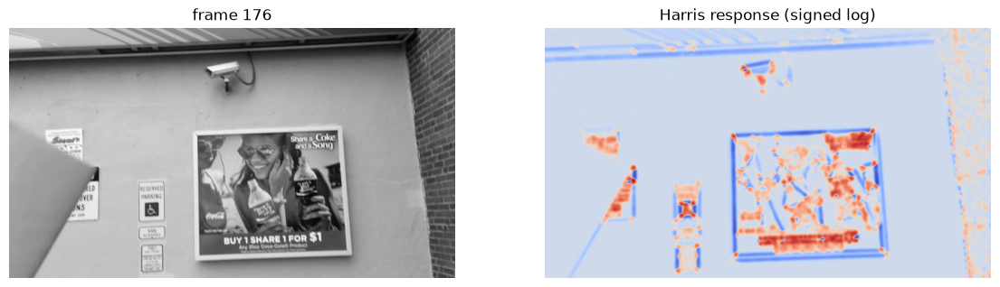

*Harris response and NMS on common validation frame 176; Notebook 1 cell 8, 640-pixel preview.* 

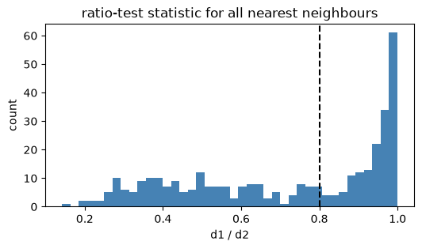

*Reference-to-common-frame-176 descriptor matches, Notebook 1 cell 12, 640-pixel preview.* 

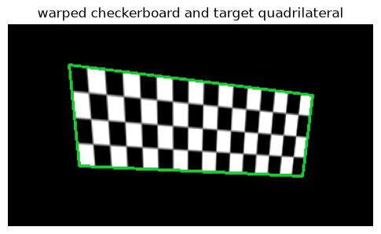

*Synthetic checkerboard inverse warp and expected pixel-centre corners; Notebook 1 cell 28, 360 by 200 output.* 

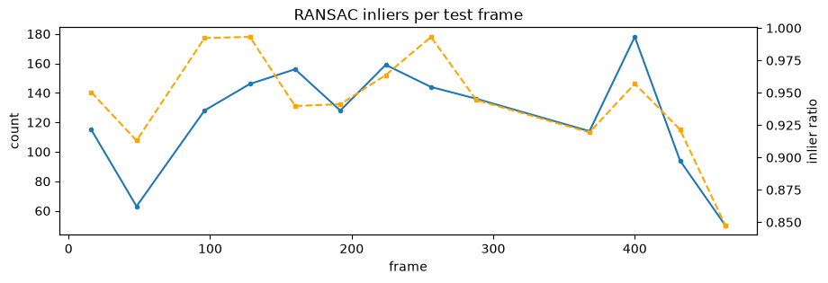

*Common test inlier count and ratio, independent localisation, 640-pixel preview; Notebook 2 cell 7.* 

The two worst **common test preview** cases are frames **160 and 48**, with corner errors **0.77% and 0.72%**, respectively. Both pass the 2% criterion; **0/13 preview test frames fail**, so these are worst available cases rather than fabricated failures. The matches/quadrilaterals and residual histograms are paired below. This differs from the native-resolution table, where 12/13 common test frames succeed. 

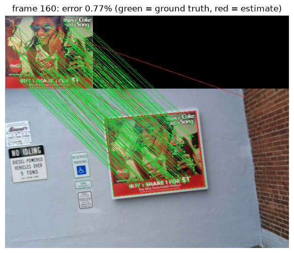

*Common test frame 160: matches and projected quadrilateral, 640-pixel preview.* 

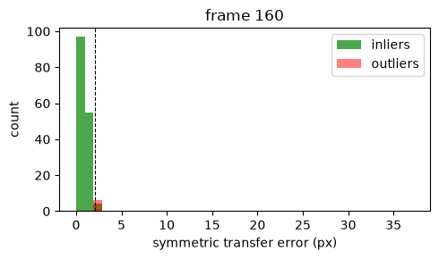

*Common test frame 160: symmetric transfer residual histogram, 640-pixel preview.* 

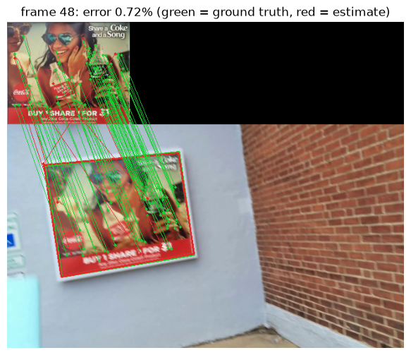

*Common test frame 48: matches and projected quadrilateral, 640-pixel preview.* 

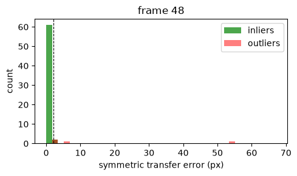

*Common test frame 48: symmetric transfer residual histogram, 640-pixel preview.* 

**RANSAC versus all-match least squares.** On the same ratio-test matches in Notebook 2 cell 9, common test frame 192 gives **0.56% versus 50.45%** corner error; frame 464 gives **0.53% versus 62.47%** (640-pixel previews). Least squares lets incorrect matches pull the fit away from the board; RANSAC isolates a consensus before refitting. It is not always a large difference: frame 96 gives **0.58% versus 0.67%**. The [complete printed comparison](student_files/notebook_evidence/nb02_outputs.txt) contains all 13 pairs, computed with `metrics.corner_error`. 

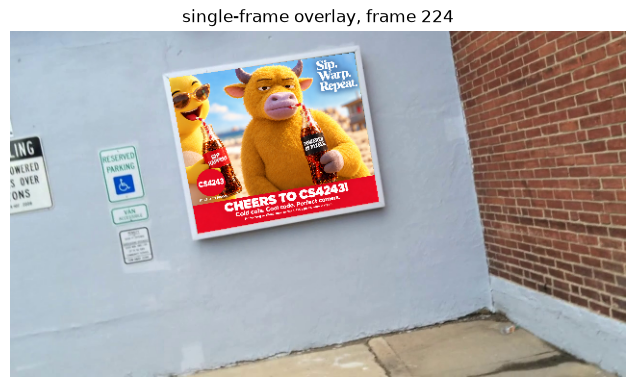

*Single-frame artwork overlay, common test frame 224, independent localisation at 640-pixel preview; Notebook 2 cell 13.* 

**Frozen success threshold:** [thresholds.json](outputs/thresholds.json) stores `success_threshold = 0.02`. As recorded in the [Notebook 2 log](student_files/02_localisation_and_temporal_check.log), this is a fixed application tolerance of 2% of the board diagonal, retained after common-validation inspection. A frame succeeds when its mean predicted-to-annotated corner distance, divided by the longer annotated diagonal, is at most 0.02. Normalisation makes the criterion comparable across board sizes and resolutions. This evaluation threshold is separate from RANSAC's match-level inlier threshold and remains fixed for subsequent test/stress evaluation. 

### Stress table (Stage 1)

| row | frames | median err | p90 err | success | inliers (median) | inlier ratio | affine median err | affine success |
|---|---|---|---|---|---|---|---|---|
| common · validation | 13 | 0.42% | 0.65% | 85% | 87 | 0.850 | 0.78% | 77% |
| common · test | 13 | 0.40% | 0.54% | 92% | 88 | 0.879 | 0.84% | 85% |
| viewpoint (coke_perspective) | 32 | 0.46% | 0.94% | 56% | 16 | 0.647 | 3.69% | 16% |
| scale (coke_scale) | 32 | 0.38% | 1.99% | 22% | 4 | 0.500 | 0.66% | 25% |

`localise_board` on every annotated frame with the frozen configuration; *affine* = 6-parameter least-squares fit to the same RANSAC inliers. 

Almost every failure here is a frame where no homography was produced at all, not a misplaced overlay. RANSAC needs at least 12 inliers, and the failed frames have 0–11 ([per-frame values](outputs/stress_tables.json)). When a model is found it is accurate, which is why the medians stay at 0.38–0.46% on every row. The success column, not the median, is what shows the stress.

- **Common clip:** fails only on validation frames 80 and 448 and test frame 48. Frames 48 and 80 are blurred by the hand-held pan, and in 448 the blue card covers most of the poster, so too few corners survive matching.
- **Viewpoint clip:** fails on 14 of 32 frames. Thirteen have no model, and they are the most oblique views (160, 240–368 and 464–496), where foreshortening distorts the descriptor patches (Question 2). Only frame 208 is a finite but misplaced estimate (2.23%).
- **Scale clip:** fails on 25 of 32. From frame 160 onward every annotated frame has no model, because the board has shrunk relative to the fixed-size reference (Question 1). Only frame 16 is finite but misplaced (2.68%).

The median-inlier column tracks this directly: 87–88 on the common clip against 16 and 4 on the stress clips. The affine columns are worse on every row, even the common clip (77% / 85% against 85% / 92%), because a hand-held camera always adds some perspective that an affine model cannot represent. 

### Question 1 — Matching
<!-- a frame pair on the viewpoint or scale clip where the matching rate collapses; rotation absorbed by the dominant orientation vs viewpoint / scale not absorbed; which descriptor component fails; the labelled SIFT cell -->

On the **scale clip (`coke_scale`), stress/test annotations, 640-pixel preview**, I selected the fixed rectified reference and **frame 400** as the failing pair. With the frozen custom detector/descriptor and ratio test, matching rate (accepted matches / reference descriptors) falls from **170/349 = 48.7%** at frame 80 to **1/349 = 0.29%** at frame 400. These are descriptor matches before RANSAC, not verified geometric inliers. The [matching-rate plot](student_files/question1/matching_rates.png), [frame-80 matches](student_files/question1/best_matches.png), [frame-400 matches](student_files/question1/worst_matches.png) and [recorded counts](student_files/question1/matching.json) document this collapse. 

The failing component is the descriptor's **fixed spatial sampling scale**. Every keypoint uses a 16 × 16 grid at the same `patch_scale`, divided into fixed spatial cells. As the board becomes smaller, that window covers a larger physical part of the poster: corresponding edges move between cells and fine detail disappears. The resulting gradient histograms differ, so the ratio test rejects most candidates. Changing viewpoint also introduces foreshortening and unequal stretching across the patch, which a single rotation cannot undo. 

Dominant-orientation normalisation absorbs **in-plane rotation** by rotating the sampling grid and expressing gradient directions relative to the dominant direction. Keypoint-centred windows also accommodate image translation. Orientation normalisation does not compensate for changes in scale, out-of-plane tilt or general perspective distortion; blur, occlusion and unstable dominant directions can still damage matching. 

The **native-resolution scale row**, evaluated with frozen `localise_board` on all 32 stress/test annotations, has only **22% success** at the 2% corner-error threshold and a median of **4 inliers**. Its **0.38% median corner error** describes only finite estimates: it does not mean localisation works reliably throughout the clip. The reference stays at a fixed size while the board's apparent size changes, so a descriptor without automatic scale selection works over a limited scale range and often leaves too few correspondences to estimate a homography. 

For comparison, I reused the SIFT baseline definition from **Notebook 1's labelled SIFT cell**, with the same 0.8 ratio test, on the same scale-clip reference/frame pairs at 640-pixel width. SIFT's matching rate is **58.5%** at frame 80 and **11.1%** at frame 400, versus **48.7%** and **0.29%** for the custom method. SIFT detects features in scale space and describes them at their selected scales, explaining its greater robustness to this size change. It still loses matches, and it is not fully invariant to general viewpoint changes. Since SIFT also uses its own detector and reference keypoints, these rates compare the two feature pipelines rather than isolating the descriptor alone. 

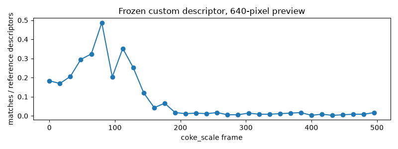

*Scale stress matching rate across annotated frames, frozen custom descriptor, 640-pixel preview.* 

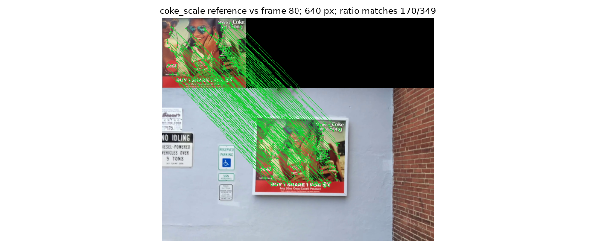

*Scale stress reference to frame 80, ratio-test matches, 640-pixel preview.* 

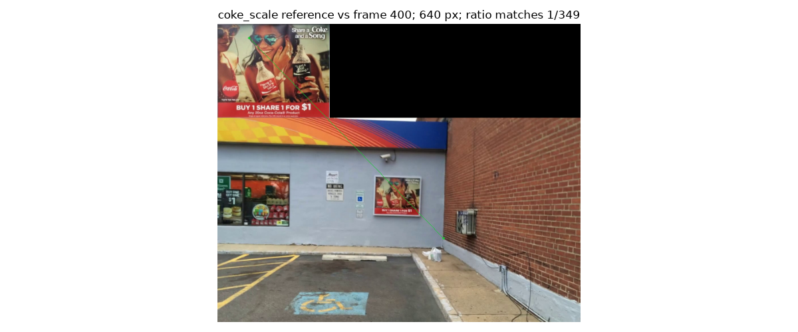

*Scale stress reference to frame 400, ratio-test matches, 640-pixel preview.* 

### Question 2 — Geometry
<!-- the affine column on the viewpoint clip: why the affine fit breaks as the camera orbits, related to the keystone; whole-frame warp and parallax; why parallax does not harm the overlay and one capture condition under which it would -->

As the camera orbits the poster in **`coke_perspective`**, its orientation and position relative to the poster change. The near and far sides have different camera depths, so perspective division produces unequal apparent scale across the board and a keystone shape. An affine transformation preserves parallel lines and cannot reproduce that projective convergence. A homography includes the perspective terms needed to map one view of a flat board to another. 

The **native-resolution viewpoint row**, using frozen settings on all 32 stress/test annotations, supports this distinction: homography median normalised corner error is **0.46%**, compared with **3.69%** for affine, and success at 2% is **56% versus 16%**. Both models use the same RANSAC inliers, so affine's additional error reflects its restricted geometry. For example, at viewpoint frame **224**, their errors are **1.15% and 9.92%**, respectively. Homography's 56% success also shows that the correct model cannot compensate for insufficient or unreliable feature matches. 

The saved **Notebook 2, Section 6** experiment warps viewpoint frame **0 into frame 208** at **640-pixel preview resolution**, using `H_0_to_208 = H_board_to_208 @ inv(H_board_to_0)`. The [target, warped frame and absolute-difference panels](student_files/question2/viewpoint_whole_frame_warp.png) show the poster brought into approximate alignment while the surrounding scene retains residual differences. In particular, the brick-wall boundary is displaced. Residual colour differences alone are not proof of parallax: illumination changes, resampling and localisation error also contribute. [AI-LANGUAGE] 

The geometric reason for **parallax** is that the board homography assumes every point lies on the board's plane. Under camera translation, a point in front of or behind that plane moves differently and is mapped to the wrong location; the residual generally grows with departure from the plane and with translation. Pure rotation about the camera centre does not produce this depth-dependent translational parallax. 

This does not harm artwork placement because the overlay is warped only onto the **planar board**, and the original background pixels outside its coverage are retained. No background alignment is required. It would harm placement if the poster were **bent or wrapped around a curved surface while the camera translates**: different parts of the intended overlay would lie off the fitted plane, causing local slipping that one homography cannot remove. A foreground object crossing the board also needs separate occlusion handling to preserve the correct visibility order. 

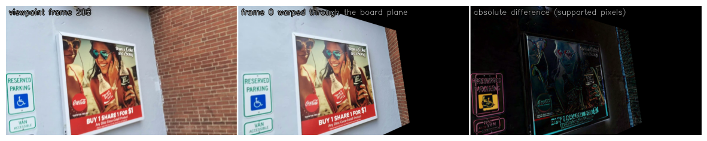

*Viewpoint stress frame 0 warped into frame 208: target, warped image and difference; 640-pixel preview, Notebook 2 labelled comparison.* 

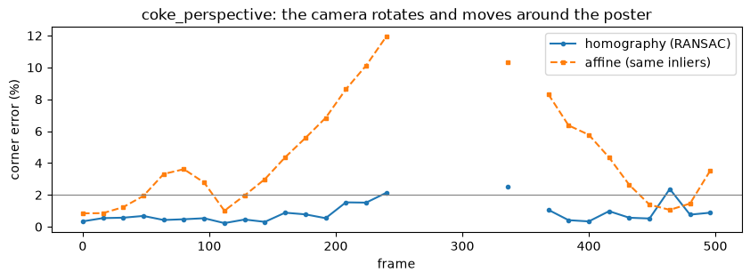

*Viewpoint stress: homography versus affine on the same inliers, annotated frames, 640-pixel preview; Notebook 2 cell 11.* 

## Stage 2 — Track

`lk_flow` samples a **15 × 15** window (`window = 7`) around each point. Sobel gradients of the previous image form the window-normalised second-moment matrix. Each iteration bilinearly samples the next image at the current displacement, solves the two-variable normal equations, and updates the displacement. The limit is **20 iterations**, with convergence below **0.01 px**; this run uses **one pyramid level**. The returned eigenvalues satisfy λ1 ≥ λ2. A point is rejected for **λ2 < 0.0002**, mean absolute brightness residual **> 0.08**, non-convergence, or a window leaving either image. Thus a well-conditioned gradient matrix alone does not guarantee a valid correspondence. 

`track_board` in **independent** mode calls `localise_board` on every frame. In **flow-assisted** mode it propagates reference/frame inlier correspondences with LK, drops invalid points, fits a new RANSAC homography from reference points to propagated points, and retains its inliers for the next frame. Actual re-localisation occurs when the previous model is absent, fewer than **20** points remain, **60 frames** have elapsed since the last call, or flow/RANSAC cannot supply a valid model. The saved mode is `propagate = "inliers"`. 

`failure_monitor` first returns **HIDE / no_model** for a lost model. Otherwise, fewer than **12 inliers** or an inlier ratio below **0.40** requests **REINIT**, escalating to HIDE after a bad run reaches **2 frames**. Next it checks, in order, median symmetric reprojection residual **> 3 px**, mean corner displacement **> 60 px**, mean valid flow **> 25 px**, and brightness change **> 0.15**; the first exceeded statistic names the REINIT trigger. NaNs do not fire, and OK resets the run. No-model and other warning frames increment the implementation's run counter. 

[AI-LANGUAGE] 

These are the existing frozen settings retained from the common-validation/synthetic workflow; the report does not claim a new optimisation. The minimum eigenvalue guards invertibility, the residual gate guards photometric agreement, point-count and interval limits restrict long unsupported tracks, and the monitor thresholds request review/hiding when geometry or appearance changes too much. **Implementation limitation:** `pipelines.run_clip` applies the monitor after the tracking pass. HIDE suppresses rendering, but a REINIT flag does **not** feed back into `track_board`; actual localiser calls follow the tracker rules above. Therefore REINIT flags and (re)localisation counts must not be equated. 

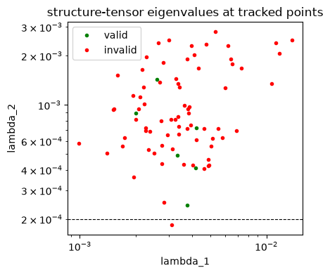

*Common frames 170 to 171, LK eigenvalues and validity, 640-pixel preview; Notebook 2 cell 15.* 

### Stress table (Stage 2)

| row | frames | median err | p90 err | success | jitter | drift (≥16 fr) | longest run | tracked | (re)localisations | REINIT flags | HIDE flags |
|---|---|---|---|---|---|---|---|---|---|---|---|
| common · validation · independent | 13 | 0.42% | 0.65% | 85% | 6.57 px | n/a | 1 | 448 | 500 | 109 | 52 |
| common · validation · flow-assisted | 13 | 0.46% | 1.12% | 85% | 6.69 px | 0.41% | 26 | 451 | 219 | 111 | 49 |
| common · test · independent | 13 | 0.40% | 0.54% | 92% | 6.57 px | n/a | 1 | 448 | 500 | 109 | 52 |
| common · test · flow-assisted | 13 | 0.51% | 0.75% | 92% | 6.69 px | n/a | 26 | 451 | 219 | 111 | 49 |
| blur (coke_blur) · flow-assisted | 32 | 0.54% | 0.70% | 9% | 4.20 px | n/a | 12 | 35 | 484 | 13 | 465 |
| exit (coke_out_of_view) · flow-assisted | 30 | 0.74% | 1.44% | 67% | 6.97 px | n/a | 14 | 346 | 354 | 140 | 154 |

From the `_stats.json` of each run. Jitter uses the full available corner trajectory for motion interpolation. Jitter, longest run, tracked and the counts are whole-clip statistics (identical in validation and test rows for a variant); (re)localisations counts actual localiser calls, whereas REINIT/HIDE count monitor flags; drift = median corner error on the row's annotated frames at least 16 frames after the last (re)initialisation (n/a when no track is carried that long: the independent variant reinitialises every frame); longest run = most consecutive frames without a (re)initialisation.

**Reading the Stage 2 table.**
- **Common clip:** the two variants reach the same success rates. The flow-assisted tracker re-localises often (219 localiser calls, longest run 26 frames), so most annotated frames are scored right after a fresh localisation in both variants; Question 3 discusses this.
- **Blur clip:** the 9% success follows from tracking only 35 of 500 frames. Blur removes the Harris corners that localisation needs, and the LK points that survive fail the residual gate (Question 3), so the monitor hides 465 frames. The low 4.20 px jitter is measured over those few tracked frames and is not evidence of stability.
- **Exit clip:** 6 of its 10 failures (frames 64, 80, 224, 368, 432 and 448) fall inside hidden episodes, such as the left-edge exit at 224–237. The tracker hides the board when it leaves and re-finds it when it returns, rather than tracking through the exit. 

### Question 3 — Tracking

**Whole-clip comparison.** On the common clip at native resolution, independent registration does **not** jitter more: its motion-subtracted jitter is **6.57 px**, versus **6.69 px** for flow-assisted registration. Both have **85% validation / 92% test success**; flow's test median error is **0.51%**, compared with **0.40%** independently. Flow retains models on **451/500** frames versus **448/500**, but makes **219** actual localiser calls, versus **500** independently. Its longest uninterrupted interval is only **26 frames**, well below the 60-frame cap, so point loss/RANSAC failure commonly forces earlier resets. There are **111 REINIT / 49 HIDE** flags for flow versus **109 / 52** independently. 

Flow can still stabilise a local interval: on **common frames 16–47**, both methods have predictions on all **32** frames, and `metrics.jitter` falls from **8.02 px independent to 7.23 px flow-assisted** using the same interpolated ground-truth motion. The plot below shows this limited improvement; it is an explanatory interval selected after evaluation, not a tuning set or a claim about the whole clip. [AI-DESIGN] 

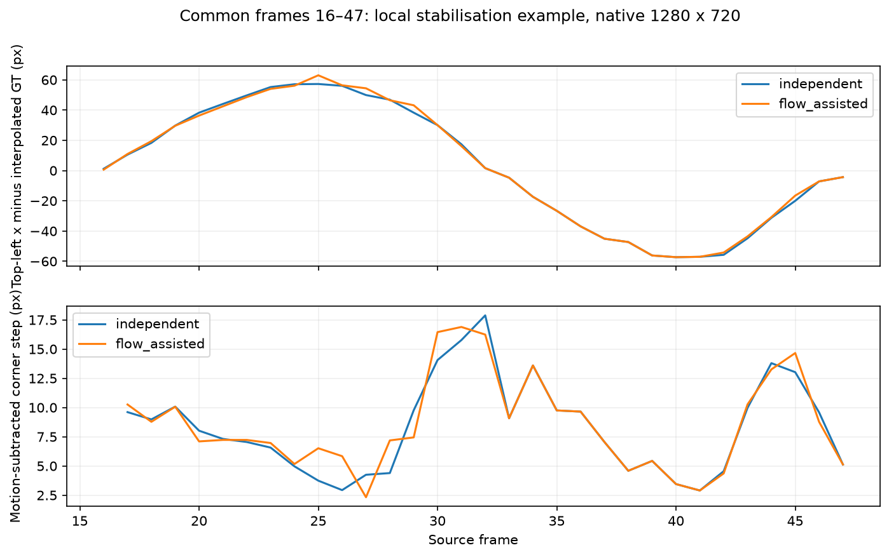

*Common frames 16–47: local stabilisation example, native-resolution independent and flow-assisted predictions, same interpolated audit motion.* 

**Drift.** The flow-assisted validation drift column is **0.41%**, but is based on only **one** eligible annotated frame: **416**, 16 frames after the localiser call at 400. Error grows from **0.34% at 400 to 0.41% at 416**, consistent with a small accumulated error on that interval; this is weak evidence, not a robust estimate of long-term drift. The common test drift entry is **n/a**, because no finite test prediction is old enough. Independent registration also has n/a because its track age is always zero. Neither n/a means zero drift. The 16-frame annotation spacing also leaves unmodelled hand-held motion between annotations, so this jitter metric is not pure algorithm noise. 

**Blur and the two eigenvalues.** The blur run retains a model on only **35/500 frames** and makes **484 localiser calls**. In the actual retained flow record for **frames 2 → 3**, **91/129 points** are valid, **34** have λ2 above 0.0002 but residual above 0.08, **4** fail other checks, and **none** have λ2 below the threshold. High-residual points cluster on the lower lettering and upper-right text. Across all **16 saved flow records**, there are no low-λ2 points: the Harris/inlier selection has already favoured corners. The actual recorded failure evidence therefore supports photometric/model mismatch, not a measured aperture failure among these retained tracks. It would be incorrect to label some of them as aperture failures just to obtain both categories. 

A separate **12-pixel grid probe** over the estimated board in the same native-resolution source frame samples straight edges that Harris tends to avoid. It finds **241 one-weak-direction windows**, **121 both-weak windows**, and **65 conditioned/high-residual windows**. Orange one-weak-direction points run along the poster border and printed contours; cyan both-weak points lie in relatively uniform areas; magenta high-residual points concentrate on lettering and fine detail. This illustrates where aperture ambiguity would occur, but these grid points are **supplementary diagnostic samples, not input to the submitted tracker**. No parameters or submitted predictions change. [AI-DESIGN] 

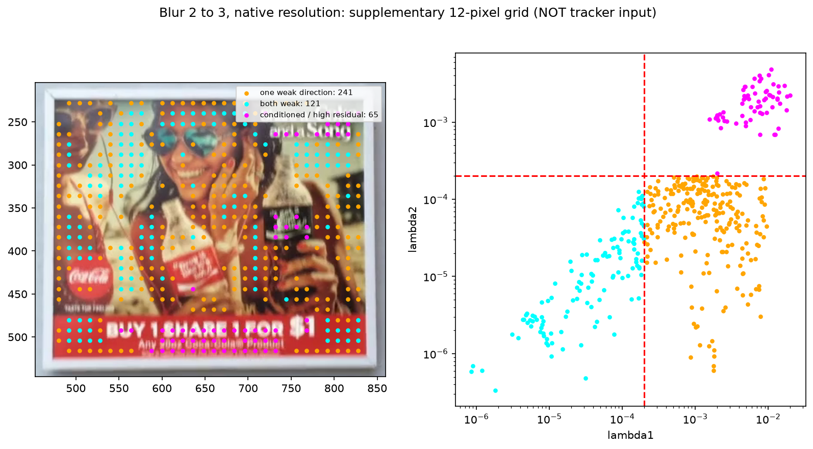

*Blur stress frames 2–3: supplementary fixed-grid aperture/texture probe at native resolution, explicitly separate from the submitted tracker.* 

The eigenvalue/residual categories identify different diagnostics, not uniquely proven physical causes. **λ1 large, λ2 small** means a predominantly one-dimensional gradient, as along an edge: motion along the edge is ambiguous. **Both small** means weak texture, possibly reduced further by blur. A point with **both eigenvalues above the minimum but a large residual** has enough local directional information yet violates the fitted translational/brightness-constancy model; blur, changing appearance, occlusion or a wrong/non-converged match can cause this. Invalid points with neither gate exceeded are reported separately rather than being called brightness failures. Failed propagation records are discarded when the tracker re-localises, so saved flow panels describe the retained records and do not exhaust every lost frame. 

**Combined clip: which trigger comes first?** The full-resolution monitor does not show a simple “card → low ratio, rotation → high flow” pattern. In the fast-rotation interval visible at **frames 64–96**, frames **62–63** are OK and the first following warning, at **64**, is **REINIT/brightness_change** (**0.159 > 0.15**). Its inlier ratio is still **0.708**, mean flow **12.22 px** and corner displacement **8.66 px**, all within their monitor bounds. Model loss then causes **HIDE/no_model at 70–71**, with repeated loss/recovery thereafter. Near the first card crossing, frame **205** requests REINIT for brightness change (**0.198**); frames **206–213** are already **HIDE/no_model**, including annotated occlusion frame **212**, before recovery to OK at **214–223**. Thus model loss takes precedence at the crossing; the saved signal cannot isolate the card as its cause from the preceding camera motion.  [AI-VISION]

At the second crossing, frames **304–307** stay OK while the propagated inlier ratio falls **0.981 → 1.000 → 0.854 → 0.756**. It never crosses the 0.40 monitor threshold. Frame **308** is actually re-localised and stays OK; the first following warning is **HIDE/no_model at 309**. Across the entire combined run, **331 flags are HIDE/no_model**, **51 are REINIT/brightness_change**, and **one is HIDE/inlier_ratio**; there are **420 localiser calls**. No mean-flow or displacement threshold fires first in this run. The monitor catches unreliable placement but **does not classify occlusion versus drift**. Spatially local losses near the card, versus distributed residual/motion changes and growing audit error, can help interpret the cause, but a falling scalar inlier ratio alone cannot distinguish them. Brightness change is measured between unaligned image regions, so camera motion can also raise it. 

**Exit and recovery.** The exit clip has **346/500 tracked frames**, **354 localiser calls**, **140 REINIT** flags and **154 HIDE** flags, with **67% success** over its 30 eligible stress annotations. All HIDE flags are `no_model`; 139 REINIT flags are brightness-change warnings and one is corner displacement. In the left-edge exit episode, **224–237** are hidden while localisation is repeatedly attempted. Frame **238** finds 65 inliers but requests REINIT because brightness change is **0.168**; frames **239–241** return to OK. Losing the board again at 242–244 produces another HIDE episode. This is repeated detection and recovery, not an invisible track maintained through the exit. The longest run is **14 frames**, so no annotated estimate reaches the 16-frame drift window.  [AI-VISION]

The final videos and statistics are linked in the evidence table. Source contact sheets for the [combined clip](student_files/tracking_evidence/coke_unconstrained_contact.png) and [exit clip](student_files/tracking_evidence/coke_out_of_view_contact.png), plus [raw diagnostic measurements](student_files/tracking_evidence/tracking.json), support the event descriptions. 

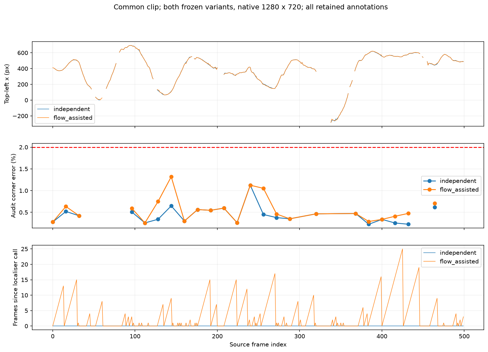

*Common full clip: projected corner, audit error and time since re-localisation, native-resolution independent and flow-assisted variants.* 

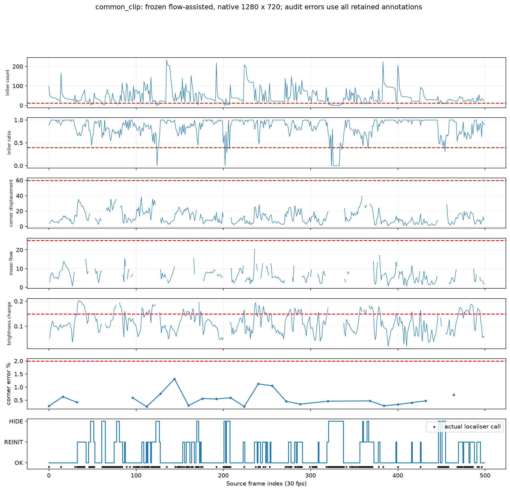

*Common full clip, native-resolution flow-assisted monitor statistics and audit errors.* 

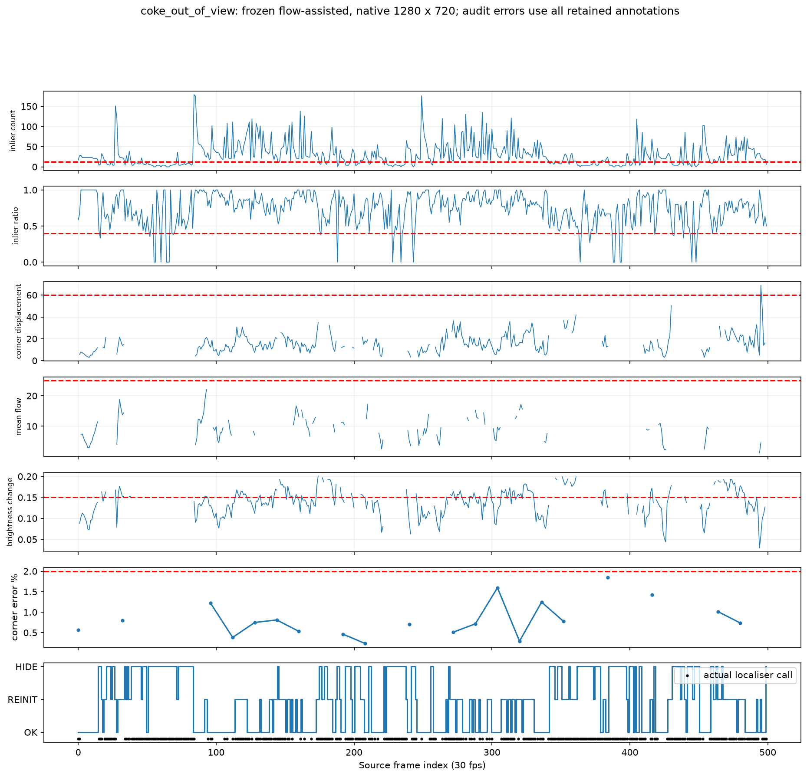

*Exit stress clip, native-resolution flow-assisted monitor timeline.* 

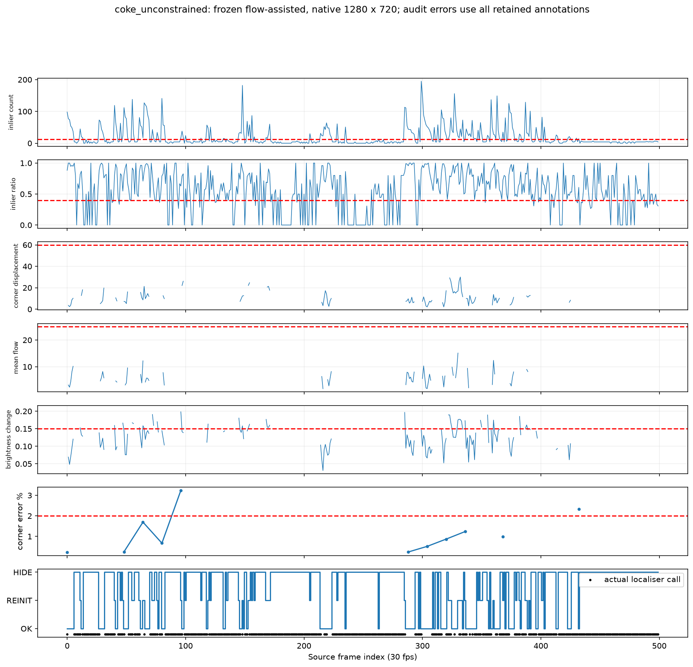

*Combined stress clip, native-resolution flow-assisted monitor timeline.* 

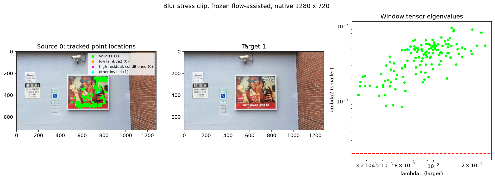

*Blur stress frame 1: actual tracked points and both tensor eigenvalues, native-resolution flow-assisted.* 

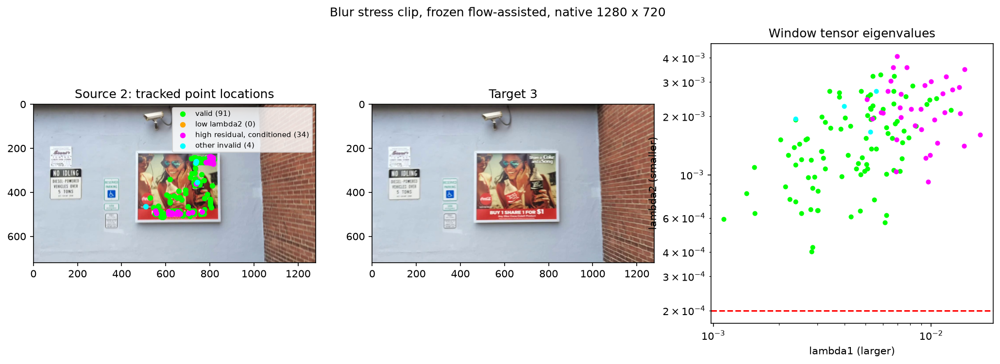

*Blur stress frame 3: actual tracked points and both tensor eigenvalues, native-resolution flow-assisted.* 

## Stage 3 — Composite

`compensated_difference` fits one global gain and offset, **I_frame ≈ a I_reference + b**, on the half of covered pixels with the smallest raw RGB difference (`gain_quantile = 0.5`). It then measures the mean absolute **colour-channel** residual and sets it to zero outside coverage. This tolerates approximately uniform lighting changes while retaining colour differences that grayscale might hide. `hysteresis` keeps weak pixels connected to a strong seed, using **8-connectivity**. 

`occlusion_mask` warps the reference with the estimated board homography, computes the compensated difference, thresholds it at **strong = 0.25 / weak = 0.12**, runs hysteresis, opens with a **radius-2 disc**, and retains connected components of at least **150 original-video pixels**. Only `min_area` rescales with image area; radius 2 and the other pixel-valued parameters remain fixed at the processed resolution. The returned components record label, position, width, height and area. 

`select_difference_thresholds` searches strong/weak/minimum-area combinations using mean `metrics.mask_iou` on common **validation masks 96, 192 and 272** only. Ties choose a strong level nearest the midpoint of the best plateau, then weak/area settings nearest the starting configuration. The saved preview search reached mean IoU **0.890**; its area round-trip is disclosed above. Common **test masks 144, 208 and 448** are held out. 

`composite` computes **α = C × (1 − O) × F** and **I_out = αW + (1 − α)I**. Here C is artwork coverage, O is the cleaned occlusion mask and F comes from distance to the visible-region boundary, reaching full opacity after **3 pixels**. This feathers both the board edge and occluder boundary. `match_gain = false`: artwork brightness is unchanged. With O = 0 the baseline paints across foreground objects. 

[AI-LANGUAGE] 

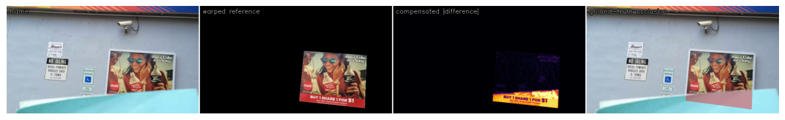

*Common validation frame 96, 640-pixel preview: original, warped reference, compensated difference and ground-truth mask; Notebook 3 cell 5.* 

### Stress table (Stage 3)

| row | eligible masks | scored masks | hidden masks | missing masks | overlay absent | IoU | F1 | leakage | baseline leakage | false occlusion |
|---|---|---|---|---|---|---|---|---|---|---|
| common · validation | 3 | 3 | 0 | 0 | 0 | 0.915 | 0.955 | 1.53% | 96.33% | n/a |
| common · test | 3 | 2 | 1 | 0 | 1 | 0.918 | 0.957 | 0.61% | 59.84% | n/a |
| combined (coke_unconstrained) | 6 | 4 | 2 | 0 | 2 | 0.936 | 0.967 | 0.21% | n/a | n/a |
| viewpoint (coke_perspective) | 3 | 0 | 1 | 0 | 1 | n/a | n/a | n/a | n/a | 10.81% |

IoU / F1 from the occlusion masks saved by `run_pipeline` on the ground-truth mask frames (frames on which the overlay is hidden are not scored); leakage, baseline leakage and false occlusion from `overlaylab.evaluate` on the finished videos. The viewpoint clip has empty masks: only false occlusion applies.

**Native-resolution interpretation.** On common validation masks **96, 192 and 272**, flow-assisted compositing scores all **3/3**, with IoU **0.915**, F1 **0.955**, and finished-video leakage **1.53%**, compared with **96.33%** for the no-occlusion baseline. On common test masks **144, 208 and 448**, IoU **0.918** and F1 **0.957** use only frames **144 and 208**; frame **448 is hidden**, not missing. Test leakage **0.61%**, versus baseline **59.84%**, averages all **three** eligible mask frames, including the zero-leakage hidden frame in both methods. Over all six common masks, visible-board coverage is **92.77% over five detected-overlay frames**; frame 448 is excluded from that coverage mean. [AI-LANGUAGE] 

The combined stress clip scores masks **216, 220, 304 and 306**, with IoU **0.936** and F1 **0.967**. Frames **212 and 314 are hidden**; there are **no missing masks**. Its finished-video leakage is **0.21% over six eligible mask frames**, while visible-board coverage is **93.98% over four detected-overlay frames**. Low leakage partly benefits from hiding, so it must be read with these counts and the Stage 2 failure analysis. 

The viewpoint stress row has **three empty masks**. Its zero “scored masks” means IoU/F1 are inapplicable for empty foreground; it does not mean there is no false-occlusion evidence. Frames **128 and 224** have detected overlays and a mean finished-video false-occlusion proxy of **10.81%** (visible coverage **89.19%**). Frame **288 is hidden/overlay-absent** and is excluded from that mean. There are **no missing masks**. 

**Why the common and combined rows score well.** The blue card is saturated and differs strongly in colour from the poster's red, white and skin tones. Most card pixels therefore exceed the strong threshold, and hysteresis fills in the rest, which gives IoU above 0.91 and leakage below 2%. The no-occlusion baseline leaks 96% on validation because it paints across almost the whole card. The test baseline's 60% is lower mostly because hidden frame 448 contributes zero leakage. The method is only as good as the colour contrast between occluder and board. That contrast is exactly what is missing on the personal clip, where a dark grey iPad crosses a dark poster (Stage 4). 

Finished-video leakage/coverage classify a pixel as painted when mean RGB change from the original exceeds **0.08**. On empty-mask frames, false occlusion is **1 − visible-board coverage**. This proxy also counts unpainted pixels caused by feathering, resampling and artwork colours similar to the original, so it is not the same as the direct predicted-mask fraction in Notebook 3. Artwork absence is determined by the evaluator's detector; although the absent frames here match HIDE, a detection failure can also cause exclusion. 

**Separate preview evidence.** Notebook 3 uses independent per-frame homographies at **640 × 360**. On common test frames **144 / 208 / 448**, mask IoU is **0.916 / 0.957 / 0.699**, F1 **0.956 / 0.978 / 0.823**, and boundary F1 **0.620 / 0.932 / 0.321**. Alpha leakage is **0.009 / 0.006 / 0.006**, compared with **0.924 / 0.969 / 0.709** without occlusion handling. All 3 preview masks are scored, none hidden. These are mask/alpha scores, not finished-video pixel-change scores, and they use the saved notebook configuration. 

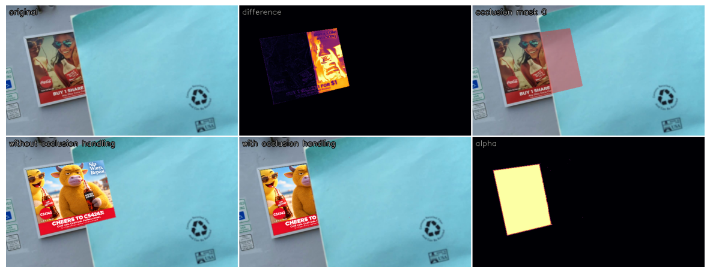

*Common test frame 144, independent-H 640-pixel preview: difference, occlusion, alpha and composites with/without handling; Notebook 3 cell 9.* 

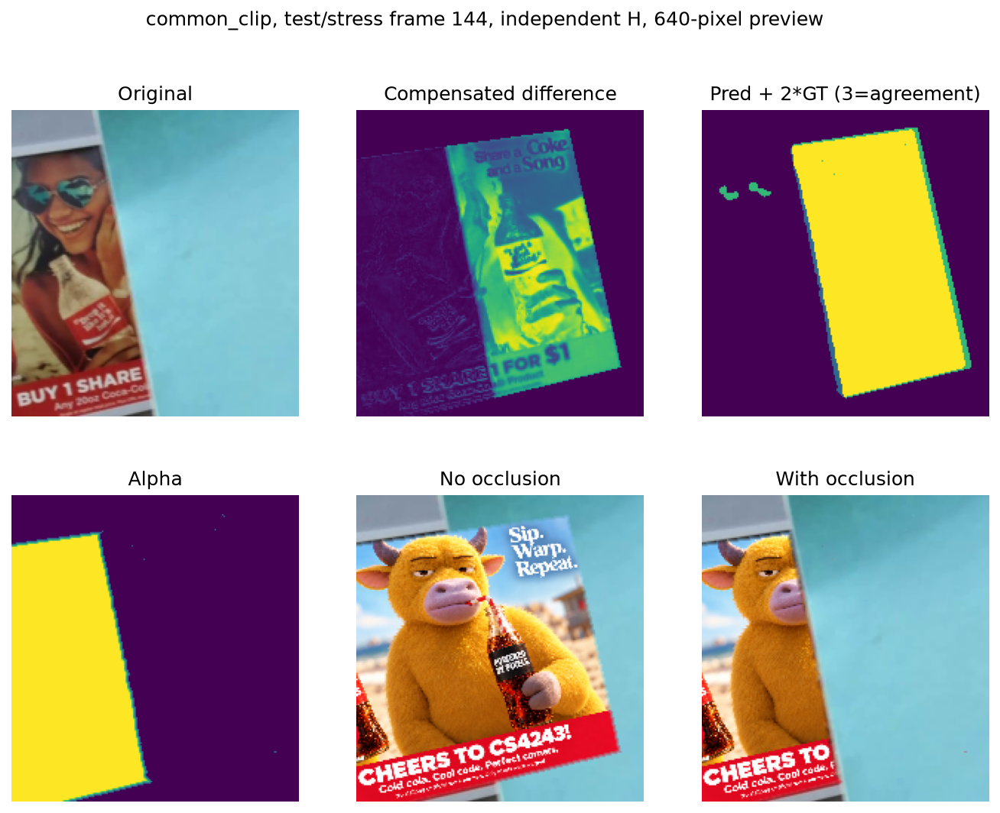

*Common test frame 144 boundary close-up; current frozen settings scaled to 640 pixels, independent estimated H.* 

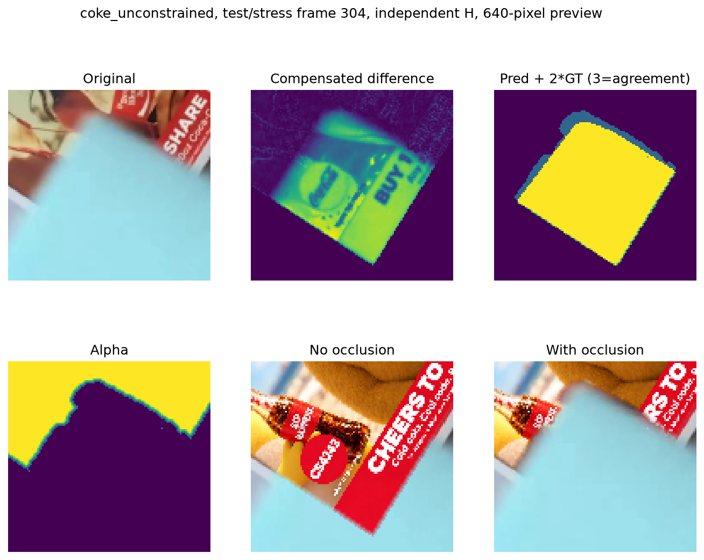

*Combined stress frame 304 boundary close-up; current frozen settings scaled to 640 pixels, independent estimated H.* 

The combined-frame close-up shows a broad blur transition around the card. The predicted mask extends beyond parts of the annotated edge: the difference signal and connected weak pixels cover a halo as well as the card. Feathering softens the join but cannot turn an overestimated mask into the correct visibility boundary. Conversely, low-difference edge pixels can be missed. This explains why a low leakage score alone does not prove good boundary placement; inspect boundary F1 and the mask overlay together. These supplementary crops use estimated homographies only, with **no GT fallback**.  [AI-VISION]

### Question 4 — Occlusion

Motion-compensated differencing detects appearance disagreement with the reference, not motion itself. A card that **stops moving** remains detectable while it looks different from the board. An occluder **coloured like the board** is ambiguous where it reproduces the reference appearance; if there is no strong seed, hysteresis cannot recover it. A **shadow** or **specular highlight** can produce a foreground-like residual despite being a lighting effect. The global fit reduces uniform gain/offset changes but cannot remove a spatially local shadow, a view-dependent reflection, or saturation. 

**Strong threshold, area and hysteresis.** Notebook 3 cell 11 changes one factor at a time on **common validation frame 192**, independent H, **640-pixel preview**, minimum area 38:

| Variant | Strong | Weak | Minimum area (processed px) | IoU | Alpha leakage | Mask pixels |
|---|---|---|---|---|---|---|
| Saved preview baseline | 0.25 | 0.12 | 38 | 0.924 | 0.001 | 16236 |
| Higher strong | 0.375 | 0.12 | 38 | 0.924 | 0.001 | 16236 |
| Larger minimum area | 0.25 | 0.12 | 228 | 0.924 | 0.001 | 16236 |
| No weak-pixel growth | 0.25 | 0.25 | 38 | 0.591 | 0.295 | 9686 |

Raising strong to 0.375 leaves enough seeds in the same connected card, so the mask is unchanged here. Raising area to 228 also leaves the large surviving component intact. In general, raising strong can remove seedless components, while raising minimum area removes small components; neither must affect a large, well-seeded card. Disabling hysteresis loses weak parts and increases leakage sharply. Thus the observed unchanged rows are meaningful, rather than evidence that these parameters never matter. 

**What opening buys.** A separate frozen-parameter comparison at **640 × 360** uses the three common validation masks, with minimum area **38** and all other settings held fixed. Values below come from [opening.json](student_files/additional_evidence/opening.json) and `overlaylab.metrics`. 

| Common validation frame | IoU, radius 0 → 2 | Boundary F1, radius 0 → 2 | False-positive pixels, radius 0 → 2 | Alpha leakage, radius 0 → 2 |
|---|---|---|---|---|
| 96 | 0.882 → 0.882 | 0.705 → 0.704 | 655 → 642 | 0.0152 → 0.0152 |
| 192 | 0.922 → 0.924 | 0.521 → 0.535 | 787 → 744 | 0.00075 → 0.00081 |
| 272 | 0.771 → 0.863 | 0.441 → 0.736 | 957 → 120 | 0.0241 → 0.0248 |

At frame 272, opening removes thin false regions and reduces the surviving components from **7 to 1**. It also removes some true pixels: false negatives rise **804 → 816**, explaining the slight leakage increase. Opening therefore improves precision/boundary quality here at a small cost in recall. 

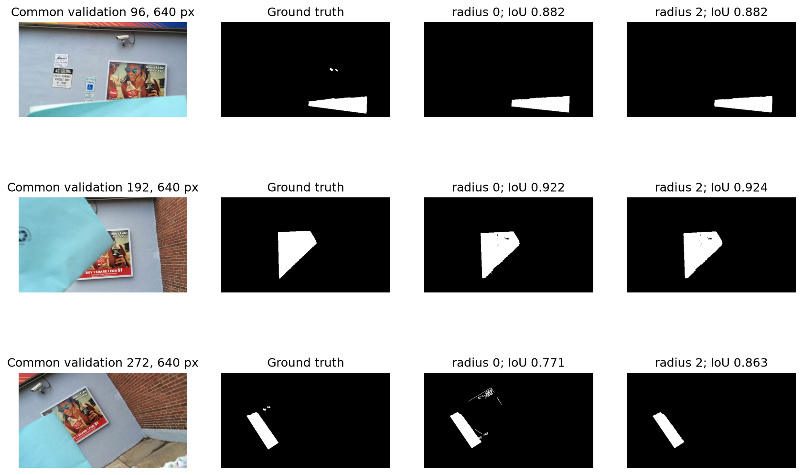

*Common validation masks 96, 192 and 272: opening radii 0 versus 2, frozen settings at 640-pixel width.* 

**Thinnest surviving structure.** In a controlled **120 × 40 synthetic difference map**, a 100-pixel-long vertical strip has residual **0.18**, with a strong **0.50** cap. With frozen strong/weak levels, radius **2** and full-resolution minimum area **150**, the narrowest tested strip surviving is **5 processed pixels wide**, retaining **488/500** pixels. Widths 2–4 survive with radius 0 but disappear with radius 2; width 1 is removed by the area cutoff even without opening. Hysteresis can carry the strong cap along a weak narrow body, but erosion requires room for the disc and destroys structures that cannot contain it. Five pixels is the observed limit for these axis-aligned strips, not a universal guarantee for arbitrary curved/diagonal objects. [AI-DESIGN] 

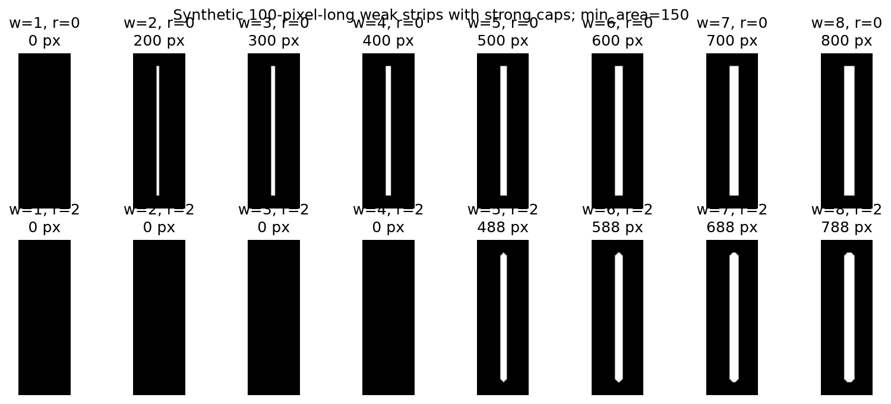

*Synthetic weak strips with strong caps, widths 1–8 pixels, radius 0 versus frozen radius 2; 120 by 40 masks.* 

**False occlusion under perspective.** Notebook 3's **viewpoint stress frame 224**, independent estimated H at **640-pixel preview**, has an empty ground-truth mask but labels **4453/40333 = 11.0%** of the visible board as occluded. Mean compensated difference is **0.305** in the false-mask pixels versus **0.083** elsewhere. Residuals concentrate around printed detail and the right/lower board borders. Foreshortening changes the sampling of high-frequency texture, so resampling/blur can leave large colour residuals even when the planar geometry is adequate; estimated-H error can add more. A single global gain and offset correct intensity relationships, not spatially varying blur or view-dependent appearance. These are supported explanations, not proof that a particular bright pixel is a physical reflection.  [AI-VISION]

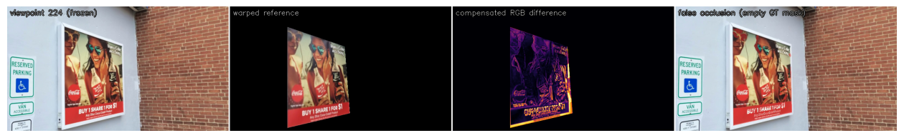

*Viewpoint stress frame 224, estimated H, 640-pixel preview: warped reference, compensated difference and false mask; Notebook 3 cell 13.* 

The notebook's **viewpoint frame 288** uses an explicitly labelled **GT-fallback** homography solely to isolate mask behaviour: **601/22029 = 2.7%** of the visible board is still falsely masked. This is **1/3 viewpoint preview rows**; the other two use estimated H, and the six combined preview rows use estimated H. The fallback demonstrates that correct corner alignment does not remove appearance residuals. It never enters the submitted videos, tracking statistics or generated stress tables. 

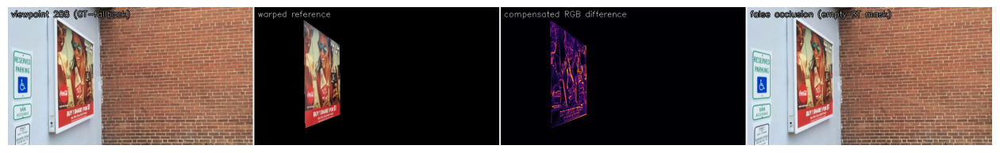

*Viewpoint stress frame 288, evaluation-only GT-fallback, 640-pixel preview; Notebook 3 cell 13.* 

## Stage 4 — Your clip
### Capture and audit

**Capture.** I filmed `personal_clip` myself, **Matthew (A0273044L)**, using an **iPhone 16 Pro Max**. The flat printed car poster is approximately **36.0 × 24.9 cm**. The supplied video contains **442 frames at a reported 30 fps**, **1920 × 1080**, giving **14.73 s**. Its annotated board occupies **45.34% of the first frame** by quadrilateral area, above the required 15%; across the eleven audit frames the area fraction ranges from **5.79% to 45.34%**. I used my **iPad** as the occluder. I am the only participant, so no other-person consent was required; I report that metadata has been removed. Metadata removal and constant per-frame timing have not been independently verified by the OpenCV inspection. See [capture manifest](manifests/capture_manifest.csv) and [measured capture evidence](student_files/stage4/capture_evidence.json). [HUMAN-DATA] 

The [source contact sheet](student_files/stage4/capture_contact_sheet.jpg) shows handheld panning, a retreat (approximately **120–216**), approach (**216–264**), in-plane rotation (**240–312**) and viewing-angle changes (**336–429**). The iPad is visible on sampled frames **48, 70, 72, 84 and 89**; crossing endpoints were not annotated. These ranges describe the source visually and are approximate. Frame **312** shows motion blur. They are not tracking predictions. [AI-VISION] 

**Audit.** Frames included in the manifests contain corners of **0, 27, 70, 84, 89, 157, 207, 258, 259, 378 and 429**, and masks of **0, 70, 84, 89 and 207**. Masks **70, 84 and 89** are nonempty; **0 and 207** are empty. The occluder description was an `iPad`. [HUMAN-DATA] 

**Artwork.** An original landscape coastal illustration was generated using the built-in image-generation tool: an uncropped PNG supplied the final **1481 × 1024** crop at [artwork.png](../data/artwork/artwork.png), approximately the board ratio **36:24.9 ≈ 1.446:1**. Both methods and their evaluation use this same final image. The exact generation prompt and provenance are in [artwork provenance](student_files/stage4/artwork/provenance.json). [AI-GENERATION] 

**Final inputs (6 November 2026).** Both methods now use [artwork.png](../data/artwork/artwork.png), **1481 × 1024**, approximately the measured board ratio; the image is used unchanged. The earlier artwork-selection notes above are historical. The rectified reference was resized from **3482 × 2408** to **1186 × 820** using Pillow LANCZOS, matching its approximate initial on-screen width as required on page 9. The [original reference](student_files/stage4/reference_original.png) and [preparation record](student_files/stage4/reference_preparation.json) are preserved. Source video, audit coordinates and frozen algorithm settings were not changed. [AI-CODE] 

[AI-LANGUAGE] 

### Overlay Scorecard

Both frozen temporal variants have now run on all **442 frames at native 1920 × 1080 resolution**, with the same final artwork and resized reference. The [measured Scorecard](outputs/scorecards/personal_clip_scorecard.md), [classical results](student_files/stage4/classical_results.json), [independent video](outputs/videos/personal_clip_independent.mp4) and [flow-assisted video](outputs/videos/personal_clip_flow_assisted.mp4) provide the classical baseline. No thresholds were retuned. [AI-CODE] 

| Full personal-clip measurement | Independent | Flow-assisted |
|---|---|---|
| Finished-video median placement error | 0.33% | 0.40% |
| Placement success, all 11 corner annotations | 7/11 | 8/11 |
| Tracker jitter | 5.208 px | 5.452 px |
| HIDE frames | 279/442 | 265/442 |
| Nonempty-mask IoU / F1 | 0.052 / 0.098 | 0.049 / 0.092 |
| Nonempty masks scored / hidden / missing | 3 / 0 / 0 | 3 / 0 / 0 |
| Finished-video leakage (3 nonempty mask frames) | 74.51% | 74.58% |
| Visible-board coverage (4 detected mask frames; frame 207 excluded) | 76.76% | 75.64% |
| Background PSNR | 38.980 dB | 38.707 dB |
| Tracking + compositing time | 365.84 s | 348.58 s |

These are **full classical-video results**, not the selected-frame GenAI comparison. The low median placement errors describe finite detections; success and HIDE counts expose the missing overlays. The poor mask IoU/F1 and high leakage show that the frozen occlusion method transfers poorly to this clip. Coverage must be read with artwork-detection exclusions in the [independent evaluator report](outputs/evaluation/personal_clip_independent_report.json) and [flow-assisted evaluator report](outputs/evaluation/personal_clip_flow_assisted_report.json). Both runs executed concurrently, so the reported wall times are not isolated speed benchmarks. 

The HIDE flags are not spread evenly. During the retreat (frames 120–216) the flow-assisted run hides **91 of 97** frames; audit frames 157 and 207 fall there, with the board at only **13.3%** and **5.8%** of the frame. The reference was resized to the board's on-screen width at the start of the clip, where it fills **45%** of the frame, and the descriptor is not scale-invariant (Question 1). Once the board shrinks by about a factor of three, too few matches survive. HIDE counts by section of the clip, flow-assisted run:

| Frames | Camera motion | Hidden |
|---|---|---|
| 0–119 | opening section | 13/120 |
| 120–216 | retreat | 91/97 |
| 217–264 | approach | 38/48 |
| 265–335 | rotation | 47/71 |
| 336–441 | viewing-angle change | 76/106 |

Of the 11 audit frames, both variants miss 157 and 207 (hidden) and 84 (4.83% error). On frame 84 the iPad covers almost half the board, so the matches most likely come only from the visible right side. Independent also hides strong-perspective frame 378, which flow-assisted carries (0.58%); that one frame is the whole difference between 7/11 and 8/11. The very low IoU/F1 and 75% leakage come from the occlusion mask missing almost all of the iPad, analysed below. Background PSNR near 39 dB means the pixels outside the board are unchanged apart from video compression, as expected when code composites only inside the board.  [AI-VISION]

**Classical failure evidence, frame 84.** The [difference/mask figure](student_files/stage4/classical_failure.png) and [numeric record](student_files/stage4/classical_failure.json) explain the iPad crossing using the saved flow-assisted prediction. Reconstructing the homography from its predicted corners reproduces the saved mask with **zero disagreeing pixels**; no audit homography is used. The global brightness fit gives gain **0.7744** and offset **0.1530**. Within the annotated iPad region, **88.00%** of pixels fall below the weak threshold **0.12**, only **3.75%** are strong seeds above **0.25**, and the final mask recovers **6.32%** of the occluder. Hysteresis cannot expand through pixels below the weak threshold; opening and component filtering cannot restore those missing regions. The output therefore paints artwork over much of the foreground, while some poster detail remains falsely protected. This is a measured transfer failure of the frozen difference thresholds, not a reason to retune them on personal audit data. [AI-CODE] [AI-VISION] 

**Why the iPad is missed.** A follow-up diagnostic ([script](student_files/stage4/classical_failure_why.py), [numbers](student_files/stage4/classical_failure_why.json)) [AI-CODE] uses the same reconstructed homography. It uses the audit mask only to explain the failure afterwards; nothing feeds back into the frozen pipeline. Four effects combine:

- **Colour similarity.** The defocused iPad back (mean RGB **0.40, 0.35, 0.35**) is close to the dark green/navy poster it hides (reference **0.27, 0.31, 0.30**). Before any correction, the iPad's median difference from the reference (**0.126**) is *smaller* than that of the visible, glare-lit poster (**0.177**). To plain differencing, the iPad looks more like the board than the board does.
- **A brightness fit pulled toward the occluder.** The iPad covers **46.4%** of the board, and the gain/offset fit uses the 50% of board pixels that agree best. **58.8%** of that fitting set is iPad, so the fit (gain 0.774, offset 0.153) partly treats the iPad as an illumination change. After compensation the iPad's median difference is **0.068** (90th percentile 0.143), below the weak threshold of 0.12.
- **Strong evidence only on thin lines.** The **18,112** iPad pixels above the strong threshold lie on the poster's bright sketch lines hidden under the iPad: mean reference luminance **0.74** there against **0.29** under the iPad overall. These are thin strokes, visible in the "Strong seeds" panel below. Hysteresis cannot widen them across the uniform iPad, and opening and the minimum-area filter remove most of what remains.
- **Thresholds frozen on a different occluder.** The thresholds were frozen on common-clip validation, where a saturated blue card crosses a bright red and white poster.

As a counterfactual, refitting gain/offset on the visible board alone (which needs the audit mask, so the pipeline cannot do it) lifts only **31.5%** of the iPad above the weak threshold and **9.0%** above the strong one. The main cause is therefore the occluder's similarity to the board, with the occluder-dominated brightness fit making it worse. Plain differencing cannot separate an occluder that matches the board's colour. A colour or texture model of the occluder, or a fit that rejects large disagreeing regions, would address it, but retuning on this test clip would break the freeze. 

### Generative comparison

**Submitted result:** Wan2.1-VACE-14B (QuantStack GGUF Q5_K_M) generated the edited pixels directly as masked video inpainting, in three segments. The [joined video](outputs/genai/output.mp4), [raw segment 0](outputs/genai/raw/segment_00_invocation_01.mp4), [raw segment 1](outputs/genai/raw/segment_01_invocation_01.mp4), [raw segment 2](outputs/genai/raw/segment_02_invocation_01.mp4), the fixed [audit extracts](outputs/genai/frame_000084.png) and the frozen [attempt state](outputs/genai/attempt.json) are in `outputs/genai/`. The coastal artwork appears on the board on clean frame 0, occluded frame 84 and perspective frame 378, and the iPad stays in front on frame 84. On the temporal pair 259/260 the model paints a car poster instead (explained below). Attempt 1, which kept the car poster everywhere because of an input-preparation error, is archived in `outputs/genai/attempt1_mv2v/` and summarised at the end of this section. [AI-GENERATION] [AI-VISION] 

**Inputs.** The model receives the source cut, the final artwork as a reference image, the prompt, and board masks rasterised from the frozen flow-assisted tracker's predicted corners. Audit corners and masks are never given to the model; they are used only for evaluation. The runner is [vace_inpaint.py](student_files/stage4/vace_inpaint.py) with frozen settings in [vace_inpaint_settings.json](student_files/stage4/vace_inpaint_settings.json). It calls ComfyUI's [`WanVaceToVideo`](https://github.com/comfyanonymous/ComfyUI/blob/master/comfy_extras/nodes_wan.py), samples, trims the reference latent and saves decoded frames directly. It performs no classical overlay, background restoration or source/generated blending. [AI-CODE]

| | Attempt 1 (archived) | Attempt 2 (submitted) |
|---|---|---|
| Pixels inside the edit mask | original poster (raw frames) | neutral grey 0.5, as in [VACE inpainting](https://github.com/ali-vilab/VACE/blob/main/UserGuide.md#31-vace-recognizable-inputs) |
| Frames the tracker lost | empty mask (201/442 frames) | convex hull of the nearest tracked quads before/after (89 of 203 input frames) |
| Mask dilation | none | 8 px at model resolution |
| Reference image | grey letterbox | stretched to the canvas |
| Prompt | generic instruction | generic instruction + one-sentence content description of the artwork |
| Resolution | 512 × 288 | 768 × 432 |
| Model, quantisation, seed, steps, CFG, sampler, shift | Q5_K_M, 42, 30, 5, UniPC/simple, 8 | unchanged |

The prompt was **"Replace the poster on the board in this video with the attached artwork: a vintage travel-poster illustration of a rocky coast with a red-and-white lighthouse on a cliff, a sailboat with a red sail on a blue sea, a large red sun, seagulls in the sky and colourful flowers in the foreground."** The negative prompt was empty, VACE strength 1, denoise 1, 81 frames per invocation at 16 fps. The [model inputs at the audit frames](outputs/genai/inputs/control_preview.jpg) show exactly what the model saw. [AI-DESIGN] 

**Settings chosen on common-clip validation only.** A full 80-frame run on common-clip frames 160–309 with the generic prompt and letterboxed `ad.png` removed the Coke poster and kept the card in front, but painted a generic yellow board. Artwork was detected on 0% of frames, NCC −0.04, background PSNR 28.3 dB, leakage 17.5% ([report](outputs/evaluation/genai_validation_common_clip_reports.json), [frames](outputs/genai_validation/common_clip/comparison.jpg)). A 33-frame ablation with one model load (4 × about 330 s) then compared reference format, prompt and strength. Letterbox or stretched references with the generic prompt gave a blank white board; strength 1.5 gave a meaningless pattern. Only the prompt that *describes* the artwork made its identity appear: the cow, the duck in sunglasses (not named in the prompt), cola bottles and the red banner, with garbled text ([ablation sheet](outputs/genai_validation/common_clip_ablation/ablation_sheet.jpg), [log](outputs/genai_validation/common_clip_ablation/invocation_log.csv)). That variant was frozen before any personal-clip generation. Wan's text encoder cannot see an "attached" image; without a description the reference latent alone was not enough. [AI-GENERATION] [AI-VISION] 

**Trimming and timing declaration.** The original **442-frame / 14.73 s** capture satisfies the 5–15 s requirement and is retained intact. Only the model input is cut to **source frames 0–378 inclusive**, **[0.000, 12.633333) s** at 30 fps, the shortest contiguous cut containing the preselected clean/occluded/perspective frames **0/84/378** and the pair **259/260**. 

| Segment | Inclusive source interval | Source time interval | Retained joined-output indices | Generated / retained frames |
|---|---|---|---|---|
| 0 | 0–149 | [0, 5) s | 0–79 | 81 / 80 |
| 1 | 150–299 | [5, 10) s | 80–159 | 81 / 80 |
| 2 | 300–378 | [10, 12.633333) s | 160–202 | 81 / 43 |

Inputs use one global 16 fps grid. Each segment repeats its last valid input frame to reach Wan's 81-frame shape. Every raw 81-frame output is preserved, and only that predeclared padding is excluded from the joined video. The **203-frame output lasts 12.6875 s**, **54.17 ms** longer than the cut because of endpoint sampling. The fixed source → output mapping is **0→0, 84→45, 259→138, 260→139, 378→202**. The pair lies in segment 1 at local indices 58/59, and source 260 is sampled from source 261 (nominal rounding, retained). No frame blending, retiming or favourable-frame search was done. [AI-CODE] 

**Compute.** One **NVIDIA GeForce RTX 5080 (16 GB)**, PyTorch 2.14.1+cu130, ComfyUI `fb2b26fd` with ComfyUI-GGUF `6ea2651e`, `--lowvram`, CPU text encoding. The submitted segments took **918.9 s, 916.1 s and 934.8 s (2769.9 s = 46.2 min)**, with **11.42 GiB** peak PyTorch-allocated GPU memory. Including validation (942 s + 1350 s), the technical-failure runs and attempt 1, logged sampling totals about 3.4 GPU-hours. Two further diagnostic invocations (about 18 min, decoded frames not kept) are described above. The frozen classical runs took 365.8 s / 348.6 s on CPU for the full 14.73 s clip. 

### Measured comparison on the fixed selected frames

All methods are scored by `evaluate_frames` on the same five source indices with the complete audit dictionary ([aggregate report](outputs/evaluation/stage4_genai_reports.json), [Wan report](outputs/evaluation/genai_frames_report.json)). The re-encoded source baseline matches Wan's 768 × 432 resolution, 16 fps sampling and two MP4 encodes. The archived attempt-1 column is included for reference only. [AI-CODE]

| Measurement | Independent | Flow-assisted | Wan VACE attempt 2 | Re-encoded source | Wan attempt 1 (archived) |
|---|---|---|---|---|---|
| Placement median | 0.39% | 0.74% | 16.83% | n/a | n/a |
| Placement success | 50.00% | 75.00% | 0.00% | 0.00% | 0.00% |
| Artwork detected | 75.00% | 100.00% | 75.00% | 0.00% | 0.00% |
| Placement frames | 4 | 4 | 4 | 4 | 4 |
| Artwork NCC | 0.3920 | 0.5626 | -0.0063 | 0.0130 | 0.0030 |
| Artwork SSIM | 0.2646 | 0.3585 | 0.0821 | 0.0867 | 0.0920 |
| Artwork structure | 0.2878 | 0.4071 | 0.0373 | 0.0044 | 0.0080 |
| Background PSNR (dB) | 38.8519 | 38.0161 | 23.6825 | 32.6908 | 28.4257 |
| Background SSIM | 0.9854 | 0.9850 | 0.9488 | 0.9726 | 0.9493 |
| Background drift (px) | 4.6902 | 4.7861 | 170.8327 | 3.8843 | 3170.6514 |
| Occluder leakage | 68.98% | 68.91% | 32.87% | 0.00% | 0.34% |
| Foreground PSNR (dB) | 11.4001 | 11.4027 | 22.1744 | 33.7403 | 25.9139 |
| Visible-board coverage | 78.75% | 78.50% | 94.22% | n/a | n/a |
| Mask frames with artwork detection | 2 | 2 | 2 | 0 | 0 |
| Pair flicker | 0.1857 | 0.1899 | 0.0762 | 0.0549 | 0.0490 |
| Pair warping error | 0.1240 | 0.1588 | 0.0706 | 0.0436 | 0.0346 |
| Pair recovered-corner jitter (px) | 18.8669 | 22.3524 | n/a | n/a | n/a |

Placement, fidelity and preservation use the four frames with direct corner annotations (0, 84, 259, 378). Wan's per-frame placement errors are **16.83% / 12.91% / n/a (not detected) / 19.41%**. Frame 260 enters only the 259/260 temporal pair, with geometry interpolated from the full audit dictionary for every method. Occlusion uses mask frames 0 and 84; only 84 has a non-empty occluder, so leakage has one scored frame and coverage two, with **0 hidden and 0 missing** for every method except the baseline and attempt 1, where the artwork is absent on both. Wan's per-frame background PSNR is 20.4 / 22.5 / 23.3 / 28.6 dB. Its drift mean (170.8 px) is dominated by a 653.7 px estimate on frame 84, where the half-frame iPad defeats the drift estimator; the other frames are 10.6, 12.7 and 6.4 px. 

### Question 5 — Reflection

**Geometric placement.** Classical flow-assisted detects the artwork on 4/4 directly annotated frames, succeeds on 3/4 at the frozen 2% threshold (median 0.74%) and keeps the keystone on perspective frame 378. Independent succeeds on 2/4 and hides the overlay on 378. Wan's board edges visibly follow the board on frames 0, 84 and 378, including the keystone at 378, yet the evaluator reports **13–19%** corner error and 0/4 success. The cause is identity, not edge placement: the model draws a recomposed crop of the artwork (sky, lighthouse and sailboat enlarged; foreground flowers and boathouse missing), so SIFT+RANSAC maps the full artwork to a stretched rectangle. The placement metric therefore cannot separate "wrong position" from "wrong content". [AI-VISION] 

**Artwork identity.** Classical copies the artwork's pixels (NCC 0.56 flow-assisted), limited by warping and false occlusion holes. Wan reproduces the artwork's *motifs* (lighthouse, red-sail boat, red sun, gulls, pier, perched gull) recognisably but not its layout, so rectified NCC is −0.006, no better than the untouched source (0.013). On the common clip the banner text "CHEERS TO CS4243!" became "CHEFR:53". The model treats the artwork as a description to illustrate, not an image to place. [AI-GENERATION] [AI-VISION] 

**Occlusion order.** On frame 84 the frozen difference mask recovers only 6.3% of the dark, low-contrast iPad, so classical paints the artwork over it: **68.9% leakage**, foreground PSNR 11.4 dB. Wan keeps the iPad in front with **32.9% leakage** and foreground PSNR 22.2 dB, even though the iPad lay *inside* the edit mask and was greyed out in the model input. The model therefore re-generated an occluder in front of the board from temporal context, not by preserving source pixels. Its 94.2% visible-board coverage means it painted the visible board rather than hiding the overlay. Leakage is still non-zero: about a third of the true iPad area on frame 84 carries artwork. [AI-GENERATION] [AI-VISION] 

**Background preservation: what the model did outside the board.** Classical leaves pixels outside the board untouched up to compression (38.0–38.9 dB, SSIM 0.985). Wan's **23.7 dB** is 9 dB below the matched re-encoded baseline (32.7 dB) even though it was given the unmasked background unchanged: VACE re-renders the whole frame through the VAE and diffusion process. Only the code proves that classical did not touch the background; PSNR alone cannot prove how pixels were produced. Wan's lower pair flicker and warping error (0.076 / 0.071 against about 0.19 / 0.12–0.16 for classical) reflect smooth re-rendering, not a more accurate edit: on that pair it shows the wrong poster. 

**Shared failure: losing the board.** Around source frames 160–245 the frozen tracker's quads collapse into slivers; its monitor flags **HIDE on 84 of 86 frames**. The classical pipeline hides its overlay there. For Wan, the same predicted quads left the original car poster visible beside the mask, and VACE propagated that poster through all of segment 1, including pair 259/260 whose own masks are correct. The generative edit inherits the classical tracker's failure, because masks are its only geometric input. I did not repair those masks after seeing this: changing inputs on test evidence would be tuning on test data. [AI-VISION] 

**Method-specific failures.** Classical: the difference-based occlusion mask misses the low-contrast iPad and ghosts the old poster through false holes on frames 0 and 84. Generative: artwork identity (recomposed crop, garbled text) and full-frame re-rendering. Generative also failed numerically: one segment produced non-finite output until sampling was synchronised. 

**Controllability.** Classical swaps the artwork or its text by replacing a PNG, with no change in behaviour. With Wan, the generic instruction plus the reference image produced blank or generic boards on validation. The edit only worked once the prompt *described* the artwork in words, so changing the artwork means rewriting that description, and exact text cannot be guaranteed. Placement and occlusion depend entirely on supplied masks. [AI-DESIGN] 

**Cost.** Classical: about 6 minutes of CPU for the full clip, plus implementation effort. Wan: about 20 GB of weights, a separate CUDA environment, **46.2 GPU-minutes** for 12.7 s of 768 × 432 output, and about 3.4 logged GPU-hours in total including validation, technical failures and attempt 1. One generation is a qualitative probe of this model and configuration, not a general ranking. The staff MiniMax-H3 example (2.7% placement, background PSNR 20 dB, leakage 8%) shows the same pattern of artwork reproduced with the background re-rendered. 

The [verification](student_files/stage4/generation_verification.json) checks the raw hashes, the 81-frame segments, the 203-frame join, exact nominal extracts, identical evaluated indices, the log rows and the executed Notebook 4. These are artifact and protocol checks, not proof of a successful visual edit. Stages 1–3 of this report are unchanged. [AI-CODE] 

There was a previous attempt at generating the output but it failed due to an issue with preprocessing where in attempt 1 the edit failed: Wan VACE kept the original car poster and never inserted the coastal artwork, so no artwork appeared in any audit frame. The cause was mostly how the inputs were set up, not the model or its sampling settings. The model was given the original poster pixels inside the edit mask instead of the neutral grey fill VACE expects for inpainting, so it was effectively told to preserve the poster. As such this would have been unfair comparison to use as it was a failure on my part, the submitted code hence contains v2 in some of the file names.

## Evidence table

| Student file | Function | Report section | Notebook figure / table / video |
|---|---|---|---|
| [keypoints.py](overlaylab/keypoints.py) | harris_response, detect_corners, describe_keypoints, match_descriptors | Stage 1 implementation; Question 1 | NB1 cells 8/12/14/16; embedded Harris/matches and scale-collapse figures; Stage 1 stress table. |
| [geometry.py](overlaylab/geometry.py) | bilinear_sample, normalise_points, dlt_homography, symmetric_transfer_error, ransac_homography, transfer_points, warp_artwork | Stage 1 geometry; Question 2 | NB1 cells 18–30, embedded checkerboard; NB2 cells 9/11/13, RANSAC/least-squares results, affine comparison and whole-frame warp. |
| [localisation.py](overlaylab/localisation.py) | localise_board, artwork_to_frame, overlay_frame, evaluate_audit_frames | Stage 1 localisation and success threshold | NB2 cells 5/7/13; embedded inlier plots, worst frames 160/48 and frame-224 overlay; native Stage 1 stress table. |
| [temporal.py](overlaylab/temporal.py) | lk_flow, track_board, failure_monitor | Stage 2 implementation; Question 3 | NB2 cells 15/17/19/21; native Stage 2 table; common comparison, blur eigenvalue panels, combined/exit timelines; both common videos. |
| [compositing.py](overlaylab/compositing.py) | hysteresis, compensated_difference, occlusion_mask, select_difference_thresholds, composite | Stage 3 implementation; Question 4 | NB3 cells 5/7/9/11/13; native Stage 3 table; common/combined boundary crops, validation opening experiment, synthetic thin strips, viewpoint false masks; common/baseline/combined/viewpoint videos. |

All cell numbers are **1-based notebook cell positions**, including Markdown cells. [Saved figure index](student_files/notebook_evidence/index.json), [Notebook 1 printed outputs](student_files/notebook_evidence/nb01_outputs.txt), [Notebook 2 printed outputs](student_files/notebook_evidence/nb02_outputs.txt), and [Notebook 3 printed outputs](student_files/notebook_evidence/nb03_outputs.txt) provide traceability. The [test log](student_files/stages1_3_tests.log) records **82 tests passed**. The [completion checks](student_files/completion_checks.json) verify embedded figures, local links, unchanged tables, eight complete videos/evaluator reports and matching frozen settings/code. 

### Required final videos and evaluator outputs

| Clip / variant | Video | Evaluator report |
|---|---|---|
| common clip independent | [MP4](outputs/videos/common_clip_independent.mp4) | [JSON](outputs/evaluation/common_clip_independent_report.json) |
| common clip flow assisted | [MP4](outputs/videos/common_clip_flow_assisted.mp4) | [JSON](outputs/evaluation/common_clip_flow_assisted_report.json) |
| common clip flow assisted no occlusion | [MP4](outputs/videos/common_clip_flow_assisted_no_occlusion.mp4) | [JSON](outputs/evaluation/common_clip_flow_assisted_no_occlusion_report.json) |
| coke perspective flow assisted | [MP4](outputs/videos/coke_perspective_flow_assisted.mp4) | [JSON](outputs/evaluation/coke_perspective_flow_assisted_report.json) |
| coke scale flow assisted | [MP4](outputs/videos/coke_scale_flow_assisted.mp4) | [JSON](outputs/evaluation/coke_scale_flow_assisted_report.json) |
| coke blur flow assisted | [MP4](outputs/videos/coke_blur_flow_assisted.mp4) | [JSON](outputs/evaluation/coke_blur_flow_assisted_report.json) |
| coke out of view flow assisted | [MP4](outputs/videos/coke_out_of_view_flow_assisted.mp4) | [JSON](outputs/evaluation/coke_out_of_view_flow_assisted_report.json) |
| coke unconstrained flow assisted | [MP4](outputs/videos/coke_unconstrained_flow_assisted.mp4) | [JSON](outputs/evaluation/coke_unconstrained_flow_assisted_report.json) |

Each MP4 also has a sibling `_stats.json` and, where mask annotations exist and the overlay is visible, a `_masks/` directory. HIDE frames are counted explicitly rather than supplied with fabricated mask files. 

## AI-use disclosure table

| Tool / model | Affected artefacts (file, cell, figure, section) | Markers | What the tool contributed | How it was verified |
|---|---|---|---|---|
| OpenAI ChatGPT-6.1 Sol | REPORT.md, Stage 1/2/3  implementation overview and frozen success threshold | [AI-LANGUAGE] | Explanations of 15 Stage 1 functions and saved success criterion. | Cross-checked in the previous session against implementation, configuration and Notebook 2 source/log. |
|OpenAI ChatGPT-6.1 Sol  | Earlier REPORT.md evidence/AI-use tables, preserved in student_files/report_before_completion.txt | [AI-LANGUAGE] | Mapped assessed functions to notebook cells and then-available evidence. | Previous source/log review; historical outstanding-work notes replaced with current evidence. |
| OpenAI ChatGPT-6.1 Sol  | [additional_evidence.py](student_files/additional_evidence.py), additional_evidence/ PNGs and JSON | [AI-CODE] [AI-DESIGN] | Added opening-radius validation comparison, controlled thin-strip test and common/combined boundary crops. | Executed using frozen settings and project metrics; raw configuration, counts and scores saved. No test/stress retuning or GT fallback. |
| OpenAI ChatGPT-6.1 Sol  | [tracking_evidence.py](student_files/tracking_evidence.py), tracking_evidence/ figures and tracking.json | [AI-CODE] [AI-DESIGN] | Plotted final statistics, localiser/monitor timelines, common-window jitter and blur point/eigenvalue diagnostics; added an explicitly separate grid probe of edge ambiguity. | Reads submitted native-resolution stats; calls project metrics; point categories use frozen eigenvalue/residual gates; diagnostic grid never enters the tracker; source frames support visual inspection. |
| OpenAI ChatGPT-6.1 Sol   | [verify_completion.py](student_files/verify_completion.py), completion_checks.json | [AI-CODE] | Checked local report links/images, unchanged table copies, video length/resolution, saved code/config fingerprints, mask accounting and evaluator-report presence. | Script executed against the completed deliverables; assertions must pass before reporting completion. |
| OpenAI ChatGPT-6.1 Sol | [wan_workflow.py](student_files/stage4/wan_workflow.py), loader CLI, Notebook 4, genai manifest and this report | [AI-CODE] [AI-DESIGN]  | Added direct VACE inference orchestration, fixed timestamp segments, raw output preservation, invocation logging, retry restrictions and identical-frame evaluation; selected the completed artwork crop; resized the reference before frozen classical runs. | Six timing/integrity tests passed; three raw model segments, fixed audit extracts and evaluator reports are now saved. See the execution row and generation_verification.json. |
| OpenAI ChatGPT Built-in image-generation tool (exact model identifier not exposed) | [artwork.png](../data/artwork/artwork.png), [prompt/provenance](student_files/stage4/artwork/provenance.json) | [AI-GENERATION] [AI-DESIGN] | Generated original landscape artwork with distinct coastal motifs; the final crop is data/artwork/artwork.png. | Inspected image dimensions and visible composition; no brand, face or text is visible.  |
| OpenAI ChatGPT-6.1 Sol  | Capture contact sheet interpretation and approximate event ranges in capture_manifest.csv / Stage 4 | [AI-VISION]  | Described visible camera motion, iPad crossings and blur from source thumbnails. | Compared with source audit frames and counts; approximate ranges are not used as pipeline labels or ground truth. |
| OpenAI ChatGPT-6.1 Sol  | [vace_inpaint.py](student_files/stage4/vace_inpaint.py), [vace_inpaint_settings.json](student_files/stage4/vace_inpaint_settings.json), [vace_ablation.py](student_files/stage4/vace_ablation.py), [genai_v2_evidence.py](student_files/stage4/genai_v2_evidence.py), [classical_failure_why.py](student_files/stage4/classical_failure_why.py) and the "Why the iPad is missed" paragraph, manifests/genai_conditions.json, Notebook 4 cells 10/12/16/18/23/24 (1-based), REPORT.md Stage 4 generative comparison and Question 5 | [AI-CODE] [AI-DESIGN]  | Wrote the inpainting runner; designed the common-clip validation ablation and the artwork-description prompt; | Model inputs inspected visually before generation; raw hashes, nominal extracts and identical evaluation indices checked by script; Notebook 4 re-executed without errors; every figure checked against the saved frames. |
| Wan2.1-VACE-14B Q5_K_M   | [generated MP4](outputs/genai/output.mp4), [raw segments](outputs/genai/raw/), [audit extracts](outputs/genai/frame_000084.png), [technical failures](outputs/genai/technical_failures/), [common-clip validation](outputs/genai_validation/), [invocation log](manifests/genai_log.csv) | [AI-GENERATION] | Generated all edited pixels of the submitted output and of the validation and failed runs. | Scored with the supplied evaluator on the same indices as classical; frames inspected; no compositing or source-pixel copying in the code path. |

